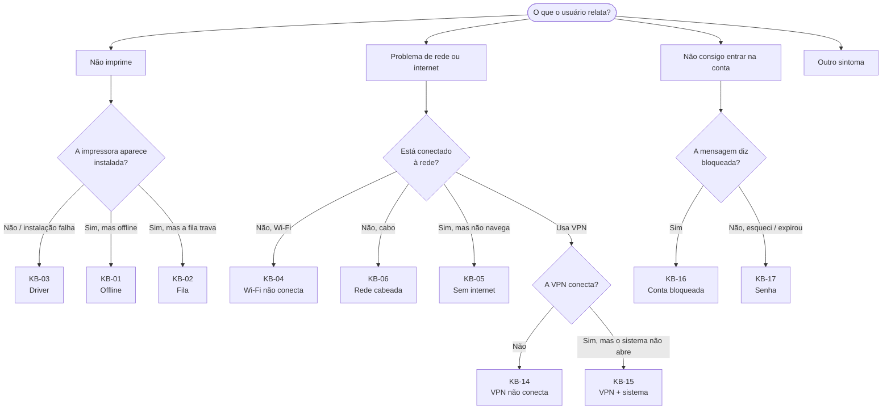

# Base de conhecimento de Suporte de TI

**20 guias de troubleshooting para Help Desk e Service Desk N1 — explicados passo a passo, com o porquê de cada ação.**

[](https://github.com/MateusSantos590/base-troubleshooting/actions/workflows/verificar-links.yml)


[Comece aqui](#comece-aqui) · [Qual guia usar?](#qual-guia-usar) · [Índice dos 20 guias](#indice) · [Método](docs/METODO.md) · [Glossário](docs/GLOSSARIO.md) · [Modelo de chamado](docs/MODELO_CHAMADO.md)

---

## O que é isto?

Uma coleção de guias para resolver os problemas mais comuns de um escritório: impressora que não imprime, Wi-Fi que não conecta, Outlook que não abre, senha esquecida, VPN que falha, e outros.

Cada guia responde a quatro perguntas:

1. **O que está acontecendo?** — o problema explicado com uma analogia do dia a dia.
2. **O que eu faço?** — passos curtos, um de cada vez.
3. **Por que estou fazendo isso?** — o motivo de cada passo, para você aprender a raciocinar e não só seguir receita.
4. **Como sei que deu certo?** — o que você deve ver e quando parar ou encaminhar.

## Para quem é?

| Você é… | Como esta base ajuda |
|---|---|
| **Iniciante** em suporte ou estudante de TI | Aprende o raciocínio de diagnóstico com linguagem simples e um [glossário](docs/GLOSSARIO.md) completo |
| **Técnico N1** | Tem um roteiro rápido e seguro para consultar durante o atendimento |
| **Recrutador ou gestor** | Vê como o autor pensa: diagnóstico, segurança, documentação e comunicação |

> [!IMPORTANT]
> **Natureza do material:** cenários didáticos, **não** chamados reais. Os procedimentos **não foram testados em laboratório** nesta versão (veja o [plano de validação](docs/VALIDACAO.md)). Adapte à versão dos produtos e às permissões da sua empresa.

---

<a id="comece-aqui"></a>
## Comece aqui — trilha em 4 passos

Se é sua primeira vez, siga nesta ordem. Leva cerca de 30 minutos.

| Passo | Leia | Por quê |
|---|---|---|
| 1 | [**O método**](docs/METODO.md) | É o raciocínio usado em **todos** os guias. Entendendo-o, você resolve até problemas que não estão aqui |
| 2 | [**Um guia simples**: KB-01 · Impressora offline](guias/kb-01-impressora-offline.md) | Para se acostumar com o formato |
| 3 | [**Um guia em camadas**: KB-05 · Conectado sem internet](guias/kb-05-wifi-sem-internet.md) | Mostra como seguir o problema de uma etapa para outra |
| 4 | [**O modelo de chamado**](docs/MODELO_CHAMADO.md) | Para registrar e encaminhar o que você descobriu |

Encontrou uma palavra estranha? Consulte o [**glossário**](docs/GLOSSARIO.md). Vai usar um comando? Veja os [**comandos explicados**](docs/COMANDOS.md).

---

<a id="qual-guia-usar"></a>
## Qual guia usar?

Comece pelo que o usuário **relata** e siga as setas.



**Sintomas que não estão no fluxograma:**

| O usuário diz… | Comece por |
|---|---|
| "O computador está lento" | [KB-09](guias/kb-09-computador-lento.md) |
| "Não consigo salvar, disco cheio" | [KB-10](guias/kb-10-pouco-espaco-em-disco.md) |
| "O programa travou" | [KB-11](guias/kb-11-aplicativo-travado.md) |
| "O Outlook não abre" | [KB-12](guias/kb-12-outlook-nao-abre.md) |
| "O e-mail não sai / não chega" | [KB-13](guias/kb-13-outlook-nao-envia-recebe.md) |
| "Ninguém me ouve na reunião" | [KB-18](guias/kb-18-microfone.md) |
| "O segundo monitor está preto" | [KB-19](guias/kb-19-segundo-monitor.md) |
| "O sistema / site não abre" | [KB-20](guias/kb-20-sistema-web.md) |
| "O nome do sistema não é encontrado" | [KB-07](guias/kb-07-falha-dns.md) |
| "Meu IP começa com 169.254" | [KB-08](guias/kb-08-ip-169-254.md) |

---

<a id="indice"></a>
## Índice dos 20 guias

| ID | Guia | Categoria | Em uma frase |
|---|---|---|---|
| <a id="kb-01"></a>KB-01 | [Impressora offline](guias/kb-01-impressora-offline.md) | Impressão | O computador não "conversa" com a impressora |
| <a id="kb-02"></a>KB-02 | [Documento preso na fila](guias/kb-02-documento-preso-na-fila.md) | Impressão | Um documento trava e segura os outros |
| <a id="kb-03"></a>KB-03 | [Driver de impressora ausente](guias/kb-03-driver-de-impressora.md) | Impressão | O Windows vê a impressora, mas não sabe usá-la |
| <a id="kb-04"></a>KB-04 | [Wi-Fi não conecta](guias/kb-04-wifi-nao-conecta.md) | Redes | A rede aparece, mas o computador não entra |
| <a id="kb-05"></a>KB-05 | [Wi-Fi conectado sem internet](guias/kb-05-wifi-sem-internet.md) | Redes | Entrou na rede, mas os dados não chegam ao destino |
| <a id="kb-06"></a>KB-06 | [Rede cabeada sem conexão](guias/kb-06-rede-cabeada.md) | Redes | Sem "sinal de linha" no cabo |
| <a id="kb-07"></a>KB-07 | [Falha de resolução DNS](guias/kb-07-falha-dns.md) | Redes | O nome do sistema não vira endereço |
| <a id="kb-08"></a>KB-08 | [IPv4 169.254.x.x](guias/kb-08-ip-169-254.md) | DHCP | O computador inventou um endereço que não funciona |
| <a id="kb-09"></a>KB-09 | [Computador lento](guias/kb-09-computador-lento.md) | Windows | Descobrir o que está lento e por quê |
| <a id="kb-10"></a>KB-10 | [Pouco espaço em disco](guias/kb-10-pouco-espaco-em-disco.md) | Windows | Liberar espaço sem apagar o que importa |
| <a id="kb-11"></a>KB-11 | [Aplicativo travado](guias/kb-11-aplicativo-travado.md) | Aplicativos | Travado, ocupado ou esperando resposta? |
| <a id="kb-12"></a>KB-12 | [Outlook clássico não abre](guias/kb-12-outlook-nao-abre.md) | Microsoft 365 | Modo seguro separa suplementos do núcleo |
| <a id="kb-13"></a>KB-13 | [Outlook não envia ou recebe](guias/kb-13-outlook-nao-envia-recebe.md) | Microsoft 365 | Compare com o webmail |
| <a id="kb-14"></a>KB-14 | [VPN não conecta](guias/kb-14-vpn-nao-conecta.md) | Acesso remoto | Internet → autenticação → túnel, nessa ordem |
| <a id="kb-15"></a>KB-15 | [VPN conecta, sistema não abre](guias/kb-15-vpn-conecta-sistema-nao-abre.md) | Acesso remoto | Nome, caminho ou permissão? |
| <a id="kb-16"></a>KB-16 | [Conta bloqueada](guias/kb-16-conta-bloqueada.md) | Identidade | Desbloquear e descobrir por que bloqueou |
| <a id="kb-17"></a>KB-17 | [Senha esquecida ou expirada](guias/kb-17-senha-esquecida-ou-expirada.md) | Identidade | Caminho oficial; o suporte nunca vê a senha |
| <a id="kb-18"></a>KB-18 | [Microfone não funciona](guias/kb-18-microfone.md) | Periféricos | Dispositivo → Windows → aplicativo |
| <a id="kb-19"></a>KB-19 | [Segundo monitor sem imagem](guias/kb-19-segundo-monitor.md) | Periféricos | Entrada, cabo ou modo de projeção? |
| <a id="kb-20"></a>KB-20 | [Sistema web não abre](guias/kb-20-sistema-web.md) | Sistemas | O código de erro aponta a camada |

---

## Como cada guia é organizado

Todos os guias seguem **o mesmo molde**, para você saber onde encontrar cada informação:

| Seção | O que responde |
|---|---|
| **Em uma frase** | A ideia central, antes de qualquer detalhe |
| **Entenda o problema** | Uma analogia do dia a dia, o sintoma e as causas comuns |
| **Pergunte primeiro** | O que perguntar ao usuário antes de mexer em algo |
| **Antes de começar** | Cuidados de segurança e o que **não** fazer |
| **Passo a passo** | Cada passo com **Faça**, **Por quê** e **O que você deve ver** |
| **Como interpretar o resultado** | Tabela "se você observar X → significa Y → faça Z" |
| **Como saber que resolveu** | Checklist de validação com o usuário |
| **O que anotar no chamado** | Evidências mínimas para o registro |
| **Quando encaminhar ao N2** | O limite do primeiro atendimento |
| **Erros comuns** | As armadilhas mais frequentes, antes que você caia nelas |

---

## As 5 regras que valem para tudo

> [!CAUTION]
> 1. **Nunca peça senha nem código de MFA.** Quem digita é sempre o usuário.
> 2. **Acesso remoto só com ciência do usuário** e por ferramenta autorizada.
> 3. **Combine antes de reiniciar ou fechar programas**, para o usuário salvar o trabalho.
> 4. **Não desative proteções** (antivírus, firewall, certificados) para testar.
> 5. **Dados reais de atendimento ficam no sistema interno** — nunca neste repositório público.

Os detalhes estão no [método](docs/METODO.md#regras-de-segurança-valem-para-todos-os-guias).

---

## Ambiente de referência

- **Sistema:** Windows 11. O Windows 10 não é o ambiente padrão desta base; avalie o ciclo de suporte antes de usá-lo.
- **Aplicativos:** Microsoft 365. O modo seguro citado vale para o **Outlook clássico**, não para o novo Outlook.
- **Rede:** pequeno escritório.

## Estrutura do repositório

```text
base-troubleshooting/
├── README.md               ← você está aqui: visão geral e índice
├── guias/                  ← os 20 guias, um arquivo por problema
│   ├── kb-01-impressora-offline.md
│   ├── ...
│   └── kb-20-sistema-web.md
├── docs/
│   ├── METODO.md           ← o raciocínio de diagnóstico (comece por aqui)
│   ├── GLOSSARIO.md        ← termos técnicos em linguagem simples
│   ├── COMANDOS.md         ← ipconfig, nslookup e ping explicados
│   ├── MODELO_CHAMADO.md   ← como registrar e encaminhar ao N2
│   └── VALIDACAO.md        ← plano para testar os guias em laboratório
├── scripts/
│   └── verificar_links.py  ← confere se todos os links internos funcionam
├── CONTRIBUTING.md         ← como sugerir melhorias
└── CHANGELOG.md            ← histórico de versões
```

---

## Referências oficiais

Consultadas em 10/11/2026. Os guias são sínteses autorais e procedimentos propostos, **não** documentação oficial da Microsoft. Valide versões e instruções locais antes de aplicar.

- [Impressão no Windows](https://support.microsoft.com/pt-br/windows/hardware/printer/fix-printer-connection-and-printing-problems-in-windows)
- [Conectividade Wi-Fi](https://support.microsoft.com/pt-br/windows/experience/connectivity-networking/fix-wi-fi-connection-issues-in-windows)
- [Comando ipconfig](https://learn.microsoft.com/pt-br/windows-server/administration/windows-commands/ipconfig)
- [Comando nslookup](https://learn.microsoft.com/pt-br/windows-server/administration/windows-commands/nslookup)
- [Diagnóstico do cliente DNS](https://learn.microsoft.com/pt-br/windows-server/networking/dns/troubleshoot/troubleshoot-dns-client)
- [Desempenho do Windows](https://support.microsoft.com/en-us/windows/experience/performance-optimization/tips-to-improve-pc-performance-in-windows)
- [Outlook clássico sem responder](https://support.microsoft.com/pt-br/outlook/classic-outlook-not-responding-stuck-at-processing-stopped-working-or-freezes)
- [Envio e recebimento no Outlook](https://support.microsoft.com/pt-br/outlook/i-can-t-send-or-receive-messages-in-outlook)
- [VPN no Windows](https://support.microsoft.com/pt-br/windows/experience/connectivity-networking/connect-to-a-vpn-in-windows)
- [Redefinição e desbloqueio por autoatendimento](https://learn.microsoft.com/en-us/entra/identity/authentication/concept-sspr-howitworks)
- [Microfone no Windows](https://support.microsoft.com/en-us/windows/hardware/drivers/fix-microphone-problems)
- [Monitor externo](https://support.microsoft.com/en-us/windows/hardware/display-graphics/troubleshoot-external-monitor-connections-in-windows)

---

## Limites desta versão

- Não foram executados testes em dispositivos, impressoras, VPN ou contas corporativas. **Todos os cenários do [plano de validação](docs/VALIDACAO.md) estão como "Não executado".**
- Antes de adotar em produção, valide em laboratório autorizado e registre ambiente, resultado e data.
- Atualizações devem sempre distinguir **hipótese**, **teste realizado** e **conclusão confirmada**.

## Contribuir

Encontrou um erro ou tem uma sugestão? Veja o [guia de contribuição](CONTRIBUTING.md). As issues são para correções da documentação — **não são canal de suporte** nem lugar para dados de clientes.

**Histórico de versões:** [CHANGELOG.md](CHANGELOG.md)

---

Portfólio de estudo de **[Mateus Santos Telles](https://www.linkedin.com/in/mateusantostelles/)**, estudante de Análise e Desenvolvimento de Sistemas. Demonstra raciocínio de diagnóstico, documentação técnica e comunicação com usuários.
