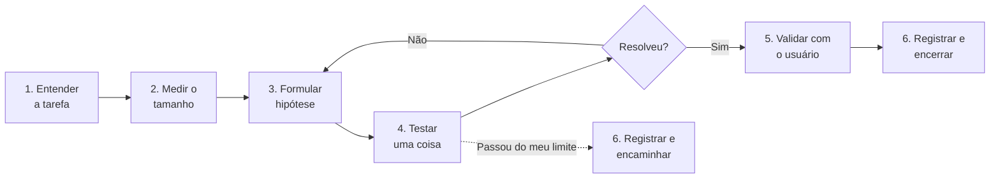

# O método — como pensar diante de qualquer problema

[← Voltar ao início](../README.md) · [Glossário](GLOSSARIO.md) · [Comandos](COMANDOS.md)

Os 20 guias desta base usam **o mesmo raciocínio**. Se você entender esta página, vai conseguir atender até problemas que não estão aqui.

---

## Por que ter um método?

Sem método, o atendimento vira tentativa e erro: reiniciar, reinstalar, trocar configuração… e, quando funciona, ninguém sabe *por quê*. Isso gera três problemas:

1. **O problema volta**, porque a causa real não foi encontrada.
2. **Algo novo quebra**, porque mudanças foram feitas sem necessidade.
3. **Ninguém aprende**, porque não ficou registro do que funcionou.

## A ideia em uma frase

> **Entenda o que a pessoa precisa fazer, descubra o tamanho do problema, teste uma hipótese de cada vez, anote o que viu e só encerre quando a tarefa original funcionar.**

## A analogia: o atendimento médico

| No consultório | No suporte de TI |
|---|---|
| "O que você está sentindo?" | "Qual tarefa você não consegue fazer?" |
| "Desde quando? Mudou algo?" | "Quando começou? Instalou ou trocou algo?" |
| "Mais alguém em casa está doente?" | "Outras pessoas têm o mesmo problema?" |
| Pede **um exame** de cada vez | Faz **um teste** de cada vez |
| Anota tudo no prontuário | Anota tudo no chamado |
| Confirma que o paciente melhorou | Pede para o usuário **repetir a tarefa** |
| Encaminha ao especialista com os exames | Encaminha ao N2 com as evidências |

Um bom médico não receita cirurgia na primeira consulta. Um bom técnico não formata o computador no primeiro chamado.

---

## Os 6 passos

### Passo 1 — Entender a tarefa, não só o sintoma

**Faça:** pergunte *o que* a pessoa estava tentando fazer e *qual mensagem* apareceu. Peça a mensagem exata (foto ou texto), sem dados sensíveis.

**Por quê:** "a internet não funciona" pode significar "não abro um site", "a VPN cai" ou "o Teams não conecta". São três problemas diferentes. A tarefa define o que você vai testar e como vai saber que resolveu.

### Passo 2 — Medir o tamanho (escopo e impacto)

**Faça:** descubra se o problema afeta **um aplicativo**, **um computador**, **várias pessoas** ou **um serviço inteiro**.

**Por quê:** o tamanho aponta onde procurar. Se dez pessoas estão sem e-mail, não adianta mexer no Outlook de uma delas — o problema provavelmente está no serviço. Se só uma pessoa tem o problema, o foco é o computador ou a conta dela.

> [!TIP]
> A pergunta mais poderosa do suporte é: **"Funciona em outro lugar?"** — outro site, outro computador, outro usuário, outra rede. Cada comparação corta o problema pela metade.

### Passo 3 — Formular uma hipótese

**Faça:** escolha a explicação mais provável **e** mais fácil de testar. Comece pelo simples (cabo solto, modo avião, entrada errada) antes do complexo.

**Por quê:** a maioria dos problemas tem causa simples. Testar o simples primeiro é rápido e não causa estragos.

### Passo 4 — Testar uma coisa por vez

**Faça:** mude **um único item**, observe o resultado e anote. Só depois mude outro.

**Por quê:** se você trocar o cabo, a porta e o driver ao mesmo tempo e funcionar, nunca vai saber qual dos três era o problema — e não vai saber resolver da próxima vez.

> [!IMPORTANT]
> **Hipótese não é causa.** "Funcionou depois que reiniciei" mostra que reiniciar ajudou, não *o que* estava errado. Registre como "contorno" quando a causa não foi confirmada.

### Passo 5 — Validar com o usuário

**Faça:** peça para a pessoa **repetir a tarefa original** e confirme o resultado com ela.

**Por quê:** o ícone de rede ficar verde não significa que o sistema da empresa abre. O que importa é a tarefa que motivou o chamado.

### Passo 6 — Registrar e encerrar (ou encaminhar)

**Faça:** anote no chamado o que foi testado, o que você viu e o que resolveu. Use o [modelo de chamado](MODELO_CHAMADO.md).

**Por quê:** o registro ajuda o próximo técnico, mostra padrões (o mesmo problema em vários chamados) e, se for preciso encaminhar, evita que o N2 repita testes.

---

## Triagem: as 6 perguntas iniciais

Faça estas perguntas antes de qualquer teste. Elas cabem em dois minutos de conversa.

| # | Pergunta | O que ela revela |
|---|---|---|
| 1 | Qual tarefa você não consegue fazer? | O objetivo e o critério de "resolvido" |
| 2 | Que mensagem aparece, exatamente? | A pista técnica mais valiosa |
| 3 | Quando começou? | Se coincide com alguma mudança |
| 4 | Mudou algo recentemente? (instalação, atualização, troca de lugar, senha nova) | A causa mais provável |
| 5 | Mais alguém está com o mesmo problema? | O escopo: individual ou coletivo |
| 6 | Há outro jeito de trabalhar enquanto isso? | A urgência real e um possível contorno |

> [!NOTE]
> A prioridade do chamado segue a **matriz de impacto e urgência** e o **SLA** da organização — não a insistência de quem pediu.

---

## Resolver, acompanhar ou encaminhar?

| Situação | O que o N1 faz |
|---|---|
| A tarefa original funcionou na frente do usuário | Registra a ação e a confirmação; encerra conforme o processo |
| Melhorou, mas a causa não foi confirmada | Registra como **contorno**; não atribui causa definitiva |
| Depende de outra equipe ou de permissão que você não tem | Encaminha com testes, evidências e um pedido específico, sem inventar prazo |
| Várias pessoas foram afetadas de repente | Verifica se há incidente conhecido e aciona o fluxo de indisponibilidade |
| Indício de fraude, vazamento ou vírus | **Para tudo** e aciona o processo de segurança |

Encaminhar não é fracasso: é reconhecer o limite da sua permissão. Encaminhar **sem evidências**, sim, é um problema.

---

## Regras de segurança (valem para todos os guias)

> [!CAUTION]
> Estas regras não têm exceção, mesmo que o usuário peça.

1. **Nunca peça senha nem código de MFA.** Quem digita a credencial é sempre o próprio usuário.
2. **Acesso remoto só com ciência do usuário** e por ferramenta autorizada pela empresa.
3. **Combine antes de reiniciar ou fechar programas** — dê tempo para salvar o trabalho.
4. **Não desative proteções** (antivírus, firewall, verificação de certificado) para "testar".
5. **Não apague dados** (arquivos, perfis, e-mails, filas de outras pessoas) sem autorização e plano de restauração.
6. **Anote a configuração original** antes de alterar qualquer coisa, para poder voltar.
7. **Evidências reais ficam no sistema interno**, nunca em repositórios públicos, chats pessoais ou prints em redes sociais.

---

## Erros que até técnicos experientes cometem

| Erro | Por que o cérebro cai nele | O que fazer |
|---|---|---|
| Pular direto para a solução que funcionou da última vez | O cérebro adora atalhos e padrões conhecidos | Confirme o sintoma antes; problemas parecidos podem ter causas diferentes |
| Mudar várias coisas de uma vez | Parece mais rápido | Mude uma coisa, observe, anote |
| Concluir pela ausência de resposta (ex.: `ping` sem resposta) | Silêncio parece "está quebrado" | Ausência de resposta pode ser bloqueio; compare com outro teste |
| Encerrar quando o ícone muda | Sinal visual parece prova | Valide a **tarefa original** |
| Achar que "conectado" = "funcionando" | Palavras de status passam confiança | Teste o recurso real que a pessoa precisa |

---

## Teste seu entendimento

1. Um usuário diz: "o sistema de vendas não abre". Antes de qualquer teste, quais **três perguntas** você faria e por quê?
2. Você reiniciou o roteador e a internet voltou. Por que isso **não** prova que o roteador era a causa? O que você escreveria no chamado?
3. Explique para alguém que nunca trabalhou com TI por que testar "uma coisa por vez" economiza tempo, mesmo parecendo mais lento.

---

[← Voltar ao início](../README.md) · Próximo: [Glossário →](GLOSSARIO.md)
