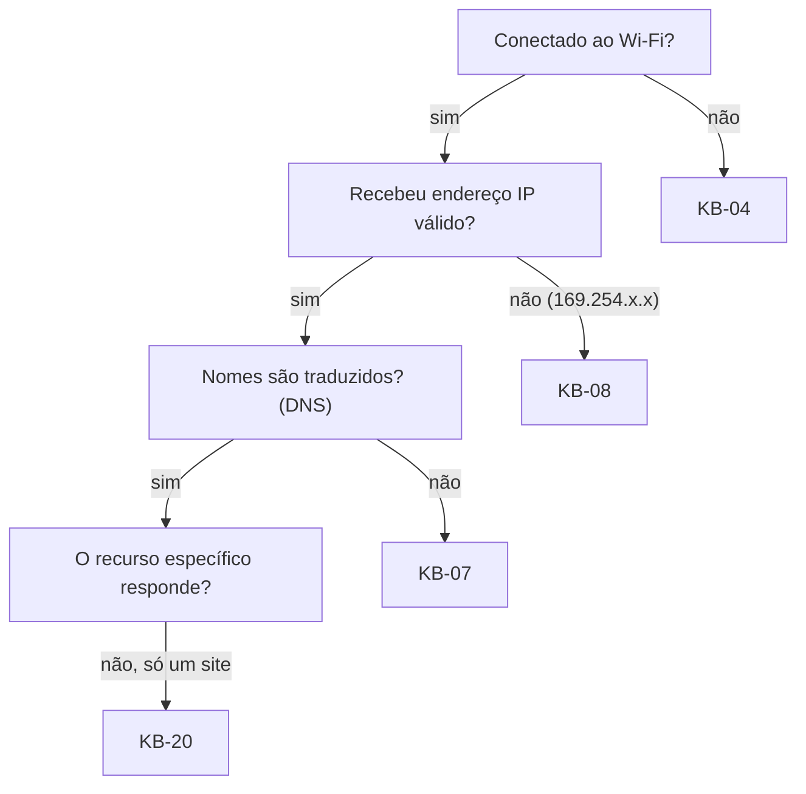

# KB-05 · Wi-Fi conectado, mas sem internet

[← Índice](../README.md#indice) · **Categoria:** Redes · **Quem executa:** N1 com o usuário

> **Em uma frase:** o computador entrou na rede, mas os dados não chegam aonde precisam. Descubra **em qual trecho do caminho** eles param.

---

## Entenda o problema

Você passou pela portaria do prédio (está conectado), mas não consegue chegar ao apartamento (o site ou sistema). Algo no caminho está bloqueado. Para encontrar o ponto exato, siga a conexão em camadas, de baixo para cima:

**Sintoma típico:** o ícone mostra conectado, mas sites ou sistemas não abrem.

**Causas mais comuns:** endereço IP inválido, DNS com falha, portal de login pendente, proxy ou indisponibilidade externa.

## Pergunte primeiro

- **Nada** abre ou só **um site/sistema**?
- Outras pessoas na mesma rede navegam normalmente?
- Esta rede costuma pedir uma página de login (hotel, visitante)?

## Antes de começar

> [!WARNING]
> **Não use "Redefinir rede"** como primeiro passo. Ela apaga configurações (incluindo VPN), pode exigir reinício e **derruba o seu acesso remoto** ao usuário.

---

## Passo a passo

### Passo 1 — Meça o tamanho do problema

**Faça:** separe três cenários: falha em **um site**, falha **neste computador** ou falha em **toda a rede**.

**Por quê:** cada cenário leva a um caminho diferente. Um site fora do ar não se resolve no computador do usuário.

**O que você deve ver:** um dos três cenários identificado.

### Passo 2 — Confira o endereço com `ipconfig`

**Faça:** abra o terminal e execute `ipconfig`. Procure o adaptador Wi-Fi e veja o **Endereço IPv4** e o **Gateway Padrão**. ([Como ler o resultado](../docs/COMANDOS.md#ipconfig--qual-é-o-meu-endereço))

**Por quê:** sem um endereço válido e um gateway, o computador não sabe sair da rede local.

**O que você deve ver:** endereço no padrão da rede e gateway preenchido.

### Passo 3 — Conclua o portal de acesso, se existir

**Faça:** se a rede exige uma página de login (comum em redes de visitante), abra o navegador e conclua o acesso **autorizado**.

**Por quê:** até aceitar os termos, a rede bloqueia a navegação, mesmo com o ícone "conectado".

**O que você deve ver:** a página de login aparecendo e, depois, a navegação liberada.

### Passo 4 — Compare um recurso interno e um externo

**Faça:** tente abrir um recurso interno conhecido (ex.: intranet) e um externo conhecido (ex.: um site público estável).

**Por quê:** se o interno abre e o externo não, o problema está na saída para a internet. Se nenhum abre, está mais perto do computador.

**O que você deve ver:** qual dos dois funciona.

> [!NOTE]
> `ping` sem resposta, sozinho, **não prova** que algo está fora do ar: muitas redes bloqueiam esse teste. Sempre confirme abrindo o recurso de verdade.

---

## Como interpretar o resultado

| Se você observar… | Provavelmente significa… | Próximo passo |
|---|---|---|
| Só **um site** falha | Problema no site ou no acesso a ele | [KB-20](kb-20-sistema-web.md) |
| Endereço começa com **169.254.** | O computador não recebeu IP do DHCP | [KB-08](kb-08-ip-169-254.md) |
| Endereço válido, mas **nomes não abrem** | Provável falha de DNS | [KB-07](kb-07-falha-dns.md) |
| Interno abre, externo não | Saída para a internet ou proxy | Encaminhe se for geral |
| Ninguém na rede navega | Falha geral | Encaminhe ao N2 |

## Como saber que resolveu

- [ ] Os recursos de que o usuário precisa abrem — não basta o ícone de rede mudar.

## O que anotar no chamado

- [ ] Adaptador em uso
- [ ] Endereço e gateway **esperados × observados** (não cole a saída bruta)
- [ ] Escopo (um site, um computador, a rede toda)
- [ ] Recursos comparados e resultado

## Quando encaminhar ao N2

- Falha geral na rede.
- Gateway ou DNS indisponível.

## Erros comuns

- **Confiar no ícone de rede.** "Conectado" não significa "funcionando".
- **Usar ping como prova** de que algo está fora do ar.
- **Redefinir a rede no primeiro minuto**, perdendo o acesso remoto e a configuração de VPN.

## Guias relacionados

[KB-04 · Wi-Fi não conecta](kb-04-wifi-nao-conecta.md) · [KB-07 · DNS](kb-07-falha-dns.md) · [KB-08 · 169.254.x.x](kb-08-ip-169-254.md) · [KB-20 · Sistema web](kb-20-sistema-web.md)

**Referências oficiais:** [Problemas de Wi-Fi no Windows][wifi] · [Comando ipconfig][ipconfig]

---

[← Anterior: KB-04](kb-04-wifi-nao-conecta.md) · [↑ Índice](../README.md#indice) · [Próximo: KB-06 →](kb-06-rede-cabeada.md)

[wifi]: https://support.microsoft.com/pt-br/windows/experience/connectivity-networking/fix-wi-fi-connection-issues-in-windows
[ipconfig]: https://learn.microsoft.com/pt-br/windows-server/administration/windows-commands/ipconfig
