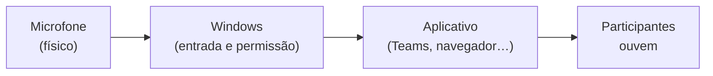

# KB-18 · Microfone não funciona

[← Índice](../README.md#indice) · **Categoria:** Periféricos · **Quem executa:** N1 com o usuário

> **Em uma frase:** o som tem que passar por três portas — o **dispositivo**, o **Windows** e o **aplicativo**. Descubra em qual delas ele para.

---

## Entenda o problema

A voz do usuário faz um caminho:

Se o Windows "ouve" mas o aplicativo não, o problema está na última porta. Se nem o Windows ouve, está antes. O **medidor de entrada** do Windows é o seu instrumento para saber até onde o som chega.

**Sintoma típico:** os participantes da reunião não ouvem o usuário.

**Causas mais comuns:** mudo ativado (físico ou no app), entrada errada selecionada, permissão negada ou microfone com defeito.

## Pergunte primeiro

- Você está usando fone com microfone, microfone do notebook ou outro?
- Funciona em algum aplicativo e não em outro?
- O fone tem botão de mudo?
- Mudou algo? (fone novo, dock, atualização)

## Antes de começar

> [!NOTE]
> Para testar, use uma frase qualquer ou uma chamada de teste. **Não grave reuniões reais** como evidência.

---

## Passo a passo

### Passo 1 — Confira o mudo

**Faça:** verifique o botão de mudo físico (no fone ou no teclado) **e** o mudo dentro do aplicativo de reunião.

**Por quê:** é a causa mais comum — e a mais rápida de resolver.

**O que você deve ver:** os dois mudos desativados.

### Passo 2 — Selecione a entrada correta

**Faça:** em **Configurações → Sistema → Som → Entrada**, escolha o microfone que o usuário quer usar. Faça o mesmo nas configurações de áudio do aplicativo de reunião.

**Por quê:** com vários dispositivos (notebook, fone, webcam), o Windows ou o app podem estar ouvindo o microfone errado.

**O que você deve ver:** o mesmo microfone selecionado no Windows e no aplicativo.

### Passo 3 — Observe o medidor e as permissões

**Faça:** peça ao usuário para falar e observe a barra do medidor de entrada no Windows. Depois, em **Configurações → Privacidade e segurança → Microfone**, confira se o acesso está permitido para o aplicativo (ou para o navegador, se a reunião é pela web).

**Por quê:** o medidor mostra se o som **chega ao Windows**. A permissão mostra se o Windows **deixa o app usar** o som.

**O que você deve ver:** a barra se movendo quando o usuário fala e a permissão ativada.

### Passo 4 — Compare para isolar

**Faça:** teste outro aplicativo (ex.: o Gravador de Voz) ou outro microfone autorizado.

**Por quê:** se funciona em outro app, o problema é do aplicativo original. Se outro microfone funciona, o problema é o dispositivo.

**O que você deve ver:** qual componente falha.

---

## Como interpretar o resultado

| Se você observar… | Provavelmente significa… | Próximo passo |
|---|---|---|
| O medidor do Windows **se move**, mas o app não capta | O problema está no aplicativo | Revise a entrada no app e a permissão do app/site |
| O medidor **não se move** | O som não chega ao Windows | Confira conexão, dispositivo e driver |
| Funciona em outro app | Configuração do aplicativo original | Ajuste o app |
| Outro microfone funciona | Defeito no dispositivo original | Registre e encaminhe para troca |
| Permissão bloqueada e não pode ser alterada | Política da empresa | Encaminhe ao N2 |

## Como saber que resolveu

- [ ] Uma chamada de teste com áudio compreensível.

## O que anotar no chamado

- [ ] Entrada selecionada (Windows e aplicativo)
- [ ] Resultado do medidor de entrada
- [ ] Resultado do teste no aplicativo
- [ ] Comparações feitas

## Quando encaminhar ao N2

- O dispositivo não aparece no Windows.
- Bloqueio por política.
- Falha física do microfone.

## Erros comuns

- **Reinstalar driver** antes de conferir o mudo e a entrada selecionada.
- **Conferir só o Windows** e esquecer a configuração do aplicativo (ou vice-versa).
- **Esquecer a permissão do navegador** em reuniões pela web.

## Guias relacionados

[KB-19 · Segundo monitor](kb-19-segundo-monitor.md)

**Referência oficial:** [Corrigir problemas de microfone no Windows][microfone]

---

[← Anterior: KB-17](kb-17-senha-esquecida-ou-expirada.md) · [↑ Índice](../README.md#indice) · [Próximo: KB-19 →](kb-19-segundo-monitor.md)

[microfone]: https://support.microsoft.com/en-us/windows/hardware/drivers/fix-microphone-problems
