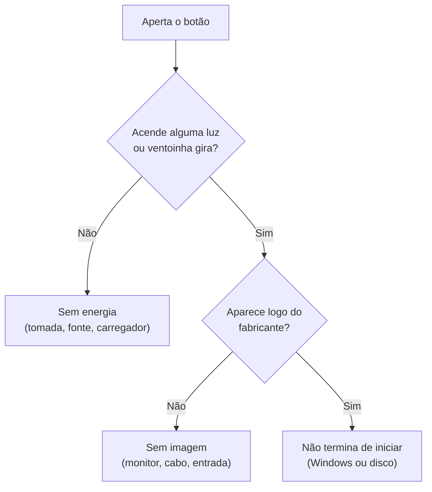

# KB-27 · Computador não liga ou não dá imagem

[← Índice](../README.md#indice) · **Categoria:** Hardware · **Quem executa:** N1 sem abrir o equipamento; reparo é do N2 ou da assistência

> **Em uma frase:** "não liga" são três problemas diferentes — **não recebe energia**, **liga mas não mostra imagem** ou **liga mas não termina de iniciar**. Descubra qual antes de qualquer coisa.

---

## Entenda o problema

Imagine um **carro que "não pega"**. Pode ser bateria descarregada (nenhuma luz no painel), motor que gira mas não pega (liga, mas não completa a partida) ou motor funcionando com os faróis apagados (ligou, mas você não vê). Cada um tem uma causa e uma solução diferente.

**Causas mais comuns:** tomada ou filtro de linha desligado, cabo de energia solto, monitor em outra entrada, notebook com bateria descarregada, carregador com defeito.

## Pergunte primeiro

- Quando você aperta o botão, **acende alguma luz**? Ouve ventoinha ou bipe?
- É notebook ou desktop?
- O monitor tem luz acesa? Mostra alguma mensagem (ex.: "sem sinal")?
- Aconteceu algo antes? (queda de energia, queda do notebook, líquido derramado)

## Antes de começar

> [!CAUTION]
> **Cheiro de queimado, fumaça, faísca ou líquido derramado:** desconecte da tomada, **não ligue de novo** e encaminhe. Bateria de notebook **estufada** (a carcaça levanta ou o touchpad fica alto) é risco de incêndio: pare o uso e encaminhe.

> [!WARNING]
> No N1, **não abra o gabinete nem o notebook**. Além do risco, pode violar a garantia.

---

## Passo a passo

### Passo 1 — Confirme a energia

**Faça:** verifique se o cabo está firme no computador e na tomada, se o filtro de linha está ligado e se a tomada funciona (teste com outro aparelho). Em desktops, confira se há um botão liga/desliga **atrás da fonte**.

**Por quê:** é a causa mais comum e a mais rápida de testar. Filtros de linha costumam ser desligados sem querer com o pé.

**O que você deve ver:** alguma luz no computador ao apertar o botão.

### Passo 2 — Notebook: carregador e reinício forçado

**Faça:** conecte o carregador original e espere alguns minutos. Depois, segure o botão de energia por cerca de 15 segundos, solte e ligue normalmente.

**Por quê:** com a bateria totalmente descarregada, o notebook pode precisar de alguns minutos de carga antes de reagir. Segurar o botão força o desligamento completo de um sistema "congelado" que parecia desligado.

**O que você deve ver:** a luz de carga acesa e o notebook ligando. Se não carrega, veja o [KB-28](kb-28-notebook-nao-carrega.md).

### Passo 3 — Liga, mas sem imagem: confira o monitor

**Faça:** verifique se o monitor está ligado, se o cabo de vídeo está firme nas duas pontas e se a **entrada** selecionada no monitor é a correta (HDMI 1, HDMI 2, DisplayPort…). Em desktops, confirme que o cabo está na saída de vídeo certa.

**Por quê:** o computador pode estar funcionando perfeitamente, só "falando" por um cabo que o monitor não está escutando.

**O que você deve ver:** imagem no monitor. Veja também o [KB-19](kb-19-segundo-monitor.md).

### Passo 4 — Desconecte periféricos

**Faça:** com o computador desligado, retire pen drives, HDs externos, dock e outros periféricos (deixe só teclado, mouse e monitor). Ligue de novo.

**Por quê:** um periférico com defeito ou um pen drive configurado como "primeiro a iniciar" pode impedir a inicialização.

**O que você deve ver:** o computador iniciando normalmente.

### Passo 5 — Observe bipes e luzes piscando

**Faça:** se o computador emite **bipes** ou uma luz pisca em padrão repetido, anote a sequência (ex.: "2 longos, 3 curtos" ou "luz âmbar pisca 3 vezes").

**Por quê:** esses padrões são códigos de diagnóstico do fabricante — cada modelo tem sua tabela. O padrão anotado poupa horas do N2 ou da assistência.

**O que você deve ver:** um padrão claro para registrar.

---

## Como interpretar o resultado

| Se você observar… | Significa… | Faça |
|---|---|---|
| Nenhuma luz, nenhum som | Sem energia | Passos 1 e 2; encaminhe se persistir |
| Luzes e ventoinha, monitor "sem sinal" | Vídeo ou monitor | Passo 3 |
| Bipes ou luz piscando em padrão | Código de hardware | Passo 5 e encaminhe |
| Logo aparece e trava ou reinicia | Problema na inicialização do Windows ou disco | Encaminhe; veja o [KB-26](kb-26-tela-azul.md) |
| Pede chave do BitLocker | Proteção de disco ativada | Procedimento oficial de recuperação |

## Como saber que resolveu

- [ ] O computador liga, mostra imagem e chega à tela de login.
- [ ] O usuário entra e abre os programas que precisa.

## O que anotar no chamado

- [ ] Tipo de equipamento e etiqueta de patrimônio (se houver)
- [ ] Qual dos três cenários (sem energia / sem imagem / não inicia)
- [ ] Bipes ou padrão de luz
- [ ] Eventos anteriores (queda, líquido, queda de energia)

## Quando encaminhar ao N2

- Sem energia mesmo com tomada e carregador testados.
- Códigos de bipe ou luz.
- Qualquer sinal de dano físico, líquido, cheiro de queimado ou bateria estufada.

## Erros comuns

- **Concluir "a placa queimou"** sem testar tomada e monitor.
- **Ligar e desligar repetidamente** um equipamento com cheiro de queimado.
- **Ignorar a entrada do monitor.**

## Guias relacionados

[KB-19 · Segundo monitor](kb-19-segundo-monitor.md) · [KB-26 · Tela azul](kb-26-tela-azul.md) · [KB-28 · Notebook não carrega](kb-28-notebook-nao-carrega.md)

**Referências oficiais:** [Central de suporte do Windows][win]

---

[← Anterior: KB-26](kb-26-tela-azul.md) · [↑ Índice](../README.md#indice) · [Próximo: KB-28 →](kb-28-notebook-nao-carrega.md)

[win]: https://support.microsoft.com/pt-br/windows
